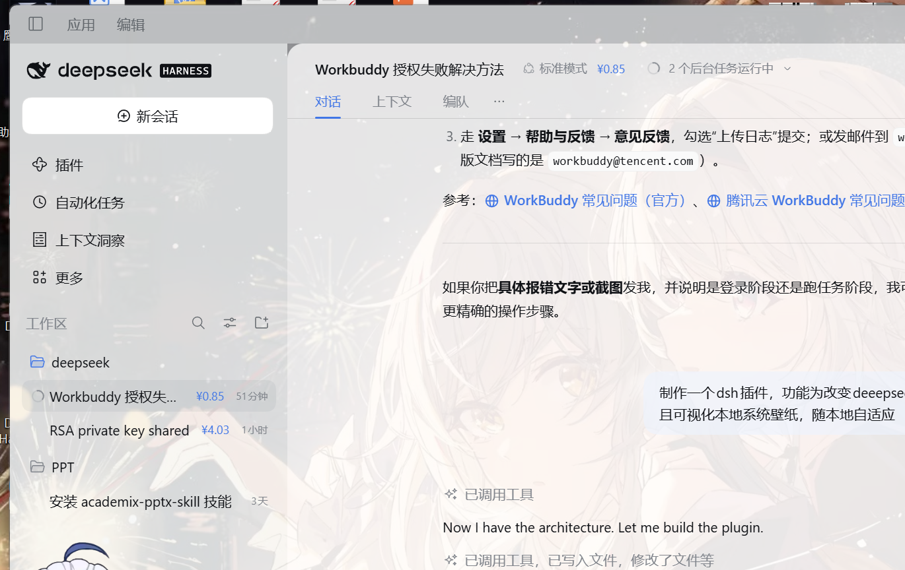

# dsh-wallpaper-glass

Puts the **local desktop wallpaper** behind the DeepSeek Harness main window: the window turns translucent, the wallpaper is pixel-aligned with the desktop (the window behaves like a hole cut into it), it follows wallpaper changes live, and it adapts the readability veil to how bright the image is. **Dialogs, menu panels and the embedded browser keep their original opaque backgrounds.**



## What it does

| Ability | How |
| --- | --- |
| Show the real local wallpaper | The Host resolves the file the OS is displaying (Windows: `TranscodedWallpaper` → registry → `CachedFiles`) and serves it over a session-guarded local route |
| Make the main window translucent | The browser half rewrites the surface tokens (`--dsw-alias-bg-*`, `--dsw-specific-sidebar-fill`, `…-input-major`, `…-bubble`) through `ctx.theme.overrideTokens`; only the main shell turns to glass |
| Pixel alignment (default on) | A screen-sized plate sits inside the fixed layer at a negative offset equal to the window's screen position, so the window shows the very same region of the desktop; moves, resizes, edge-snaps and maximized windows are followed within 250 ms (negative origins, including Windows' -8 maximized frame, stay aligned) |
| Follow the desktop fill mode | Reads `WallpaperStyle` / `TileWallpaper` and supports fill / fit / stretch / center / tile |
| Follow the local wallpaper | The page asks `/dsh-wallpaper/meta` every 4 s; the Host only `stat`s the file. A new `mtime-size` revision swaps the image, slideshow included |
| Adapt to brightness | The image is averaged on a 32 px canvas; a light theme hazes a dark wallpaper and a dark theme deepens a bright one |
| Keep overlays solid | Dialogs (`role=dialog`), menus/lists/tooltips (`role=menu/listbox/tooltip`) and the panels around embedded `iframe`/`webview` elements are reset to the original opaque palette |
| Keep inputs solid | The composer's surface token is no longer overridden, and every search/text field finds whichever ancestor actually paints its background and marks it `data-dshp-solid`, restoring the original palette |
| Deepen light labels | In the light theme `label-secondary` / `label-tertiary` / `label-caption` / `menu-icon` each drop one palette step (secondary `#61666b → #353638`), placeholders included; the dark theme keeps its original values |

## The corner control

A draggable `◐` pill sits in the bottom-right corner (its position is remembered):

- **壁纸** — show / hide
- **透明度** — subtle / medium / strong
- **虚化** — 0 / 8 / 16 / 28 px
- **对齐桌面** — on / off
- **重置本机设置**

Choices live in `localStorage`, so they survive reloads and restarts. Set `controls: false` to remove the pill entirely.

## Configuration

Appended to the profile's `cordis.patch.yml` by the installer:

```yaml
- id: ui-wallpaper-glass
  config:
    intensity: medium   # subtle | medium | strong
    align: true         # pixel-align with the desktop (on by default)
    blur: 0             # 0-40 px blur applied to the wallpaper itself
    pollMs: 4000        # how often the page asks whether the wallpaper changed
    imagePath: ''       # pin one image instead of following the system wallpaper
    controls: true      # corner pill
    enabled: true
```

## Install / uninstall

```powershell
# from GitHub
dsh plugin --profile desktop add github:talulra/dsh-wallpaper-glass

# local development, from a checkout
dsh plugin --profile desktop add link:C:\deepseek\dsh-wallpaper-glass

# uninstall
dsh plugin --profile desktop remove dsh-wallpaper-glass
```

Installing writes the dependency into the profile manifest and appends the bundle to `dsh.profile.bundles`. With HMR enabled a saved config recomposes live; otherwise restart the client.

## How it works

```
browser (client/client.js)                        Host (lib/index.js)
──────────────────────────                        ────────────────────
GET /dsh-wallpaper/meta every pollMs  ────────▶  resolve the current wallpaper file,
                                                 answer rev = mtime-size
rev changed → GET /dsh-wallpaper/image ──────▶   read + sniff JPEG/PNG/BMP/WEBP,
                                                 cache by rev, ETag
fetch → blob → object URL → plate                 (the image must travel over fetch:
canvas luminance → veil → plate offset            the shell's dsh-app:// protocol
ctx.theme.overrideTokens(...) → glass             layer only guarantees static assets)
POST /dsh-wallpaper/ping (mount beacon) ─────▶   write $DSH_HOME/.dsh-wallpaper-glass.json
```

- Structure: `#dshp-wallpaper` (fixed, `z-index:-1`, `overflow:hidden`) contains `#dshp-plate` (screen-sized, negative offset, `background-size: cover`), so the window reveals exactly the desktop region behind it.
- When the window is on a secondary display, at a negative origin, or the metrics are unavailable, it falls back to covering the window itself (`data-align="fallback"`) instead of showing a gap.
- `html/body/#root` are forced transparent; dialogs and embedded browsers reset the tokens to their original opaque values, and the two panel levels around an `iframe`/`webview` get a `data-dshp-solid` marker.
- All three routes go through `connection.requestRejection()`, so the wallpaper is never served to an unauthenticated request.
- File reads retry three times, because Windows can hold `TranscodedWallpaper` while it rewrites it.

## Compatibility and known limits

- **Windows** — prefers `%APPDATA%\Microsoft\Windows\Themes\TranscodedWallpaper`, then the `WallPaper` registry value, then the newest file in `Themes\CachedFiles`.
- **macOS** — `osascript` desktop picture; **Linux** — `gsettings picture-uri`. Both are best-effort and assume the fill mode.
- **Multiple monitors** — Windows' `TranscodedWallpaper` is the primary display's composite; a window dragged to another display falls back to covering itself.
- **Position precision** — depends on `window.screenX/screenY` and `screen.width/height` in CSS px; frameless windows (this app) align exactly, framed windows can be a few pixels off.
- **Plain browser access** — the wallpaper still renders inside the page, but the browser window is opaque, so there is no "hole in the desktop" effect.
- **Older DSH** — without `overrideTokens` the wallpaper layer still renders and no transparency is applied.

## Development

```powershell
node dev/detect-test.mjs    # wallpaper resolution only
node dev/route-test.mjs     # exercise the three HTTP routes
node dev/preview.mjs        # DSH-like preview; ?overlays=1 shows dialog/menu/browser fixtures
```

`dev/preview.mjs` accepts `?screen=1920x1080,400,300&dpr=1` to simulate display geometry for the pixel-alignment check; screenshots can be taken with headless `msedge --headless --screenshot`.
