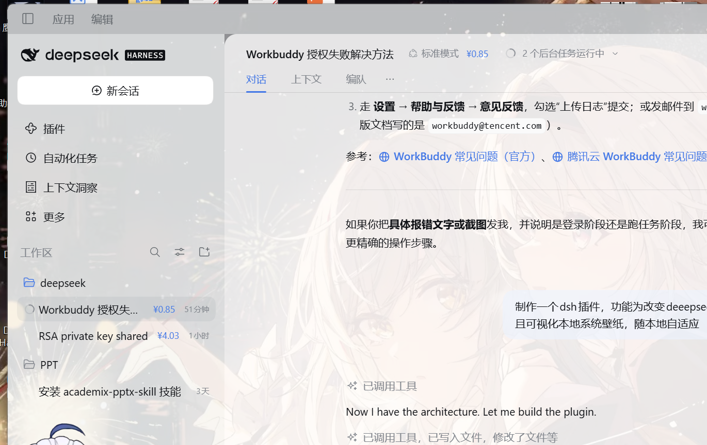

# dsh-wallpaper-glass

把**本地系统壁纸**铺到 DeepSeek Harness 主窗口背后：主窗口半透明，壁纸与桌面逐像素对齐（窗口像在桌面上挖了个洞）；换壁纸、幻灯片切换时自动跟随，并按壁纸明暗自动调节可读性蒙层。**对话框、菜单面板、内嵌浏览器保持原本不透明背景**。



## 它做了什么

| 能力 | 实现 |
| --- | --- |
| 可视化本地壁纸 | Host 端读取系统当前显示的壁纸（Windows：`TranscodedWallpaper` → 注册表 → `CachedFiles` 三级回退），经带会话鉴权的本地路由下发 |
| 主窗口透明化 | 前端用 `ctx.theme.overrideTokens` 把 `--dsw-alias-bg-*` / `--dsw-specific-*` 表面 token 改成半透明，仅主界面变玻璃 |
| 像素对齐（默认开） | 壁纸层内放一块「屏幕大小」的画板，按窗口在屏幕上的位置做负偏移，窗口显示的就是桌面上同一块区域；窗口移动/缩放/贴边/移出屏幕边缘/最大化 250ms 内跟上 |
| 跟随系统填充方式 | 读注册表 `WallpaperStyle`/`TileWallpaper`，支持 填充(fill) / 适应(fit) / 拉伸(stretch) / 居中(center) / 平铺(tile) |
| 随本地自适应 | 页面每 4 秒问一次 `/dsh-wallpaper/meta`（Host 只做一次 `stat`，无常驻定时器）；`mtime-size` 变化即换图，幻灯片也跟随 |
| 自动明暗适配 | 壁纸缩到 32px 画布求平均亮度：浅色主题给暗壁纸加白雾、深色主题给亮壁纸加暗雾 |
| 浮层保持原样 | 对话框（`role=dialog`）、菜单/列表/提示（`role=menu/listbox/tooltip`）、内嵌浏览器（iframe/webview 所在面板）重置为原始不透明配色 |
| 输入框保持原样 | 对话输入框（`--dsw-specific-input-major`）不再改透明度；搜索框/文本框会沿 DOM 向上找到真正绘制底色的那层，打上 `data-dshp-solid` 恢复原背景 |
| 浅色文字加深 | 浅色主题下 `label-secondary` / `label-tertiary` / `label-caption` / `menu-icon` 各加深一档（如 secondary `#61666b → #353638`），占位符同步变深；深色主题保持原值 |

## 右下角控件

右下角有一个可拖动的 `◐` 小圆钮（位置会记住）：

- **壁纸**：显示 / 隐藏
- **透明度**：弱 / 中 / 强
- **虚化**：0 / 8 / 16 / 28 px
- **对齐桌面**：开 / 关
- **重置本机设置**

所有选择存在浏览器 `localStorage`，刷新、重启都保留；不想要控件就把下面的 `controls` 设成 `false`。

## 配置

profile 的 `cordis.patch.yml` 里（安装时已自动追加）：

```yaml
- id: ui-wallpaper-glass
  config:
    intensity: medium   # subtle | medium | strong
    align: true         # 像素对齐桌面（默认开）
    blur: 0             # 0-40，给壁纸本身加虚化
    pollMs: 4000        # 询问壁纸是否变化的间隔
    imagePath: ''       # 固定一张图，留空则跟随系统壁纸
    controls: true      # 右下角控件
    enabled: true
```

## 安装 / 卸载

```powershell
# 安装（从 GitHub）
dsh plugin --profile desktop add github:talulra/dsh-wallpaper-glass

# 本地开发时改用 link:
dsh plugin --profile desktop add link:C:\deepseek\dsh-wallpaper-glass

# 卸载
dsh plugin --profile desktop remove dsh-wallpaper-glass
```

安装会把依赖写进 profile 的 `package.json` 并加入 `dsh.profile.bundles`。DSH 开了 HMR 时保存配置即热重载，否则重启客户端生效。

## 原理

```
浏览器（client/client.js）                       Host（lib/index.js）
──────────────────────────                       ────────────────────
每 pollMs GET /dsh-wallpaper/meta   ────────▶   解析当前壁纸文件，返回 rev = mtime-size
rev 变化 → GET /dsh-wallpaper/image ────────▶   读文件、嗅探 JPEG/PNG/BMP/WEBP、按 rev 缓存
fetch → blob → objectURL → 画板                  （图片必须走 fetch：桌面壳的 dsh-app://
canvas 求亮度 → 蒙层 → 计算画板偏移              协议层只保证静态资源，不保证插件二进制）
ctx.theme.overrideTokens(...) 改表面透明度
POST /dsh-wallpaper/ping（挂载信标） ───────▶  写 $DSH_HOME/.dsh-wallpaper-glass.json
```

- 结构：`#dshp-wallpaper`（fixed，z-index:-1，overflow:hidden）内含 `#dshp-plate`（屏幕尺寸、负偏移、`background-size: cover`）。这样"窗口"看到的就是桌面同一位置的那一块。
- 负坐标是合法状态：贴左、被拖出屏幕左边一部分、或最大化（Windows 会报 `-8` 的不可见边框）都继续用同一套偏移对齐，不会退回整窗铺满。
- 只有在「换了显示器」（`screen.availLeft/availTop` 不为 0）或窗口原点完全越出当前屏幕时，才回退成"整窗铺满"（`data-align="fallback"`），不会出现空白。
- `html/body/#root` 强制透明；对话框与嵌入式浏览器通过令牌重置回到原始不透明配色，内嵌框架（iframe/webview）周围两层面板会被打上 `data-dshp-solid` 标记。
- 三条路由都过 `connection.requestRejection()`，未登录请求拿不到壁纸。
- 读取带 3 次重试：Windows 重写 `TranscodedWallpaper` 的瞬间可能短暂占用文件。

## 兼容性与已知限制

- **Windows**：首选 `%APPDATA%\Microsoft\Windows\Themes\TranscodedWallpaper`，其次注册表 `WallPaper`，最后 `CachedFiles` 里最新的图。
- **macOS**：`osascript` 当前桌面图片；**Linux**：`gsettings picture-uri`。两者只做尽力而为，填充方式按 fill 处理。
- **多显示器**：Windows 的 `TranscodedWallpaper` 是主屏合成图；窗口拖到副屏会回退成整窗铺满。
- **窗口位置精度**：依赖 `window.screenX/screenY` 与 `screen.width/height`（CSS px）；窗口有原生边框时会有几像素偏差，无边框窗口（本应用）为精确对齐。
- **纯浏览器访问**：页面内同样显示壁纸，但浏览器窗口本身不透明，没有"窗口即桌面开孔"的层叠感。
- **旧版 DSH**：若主题服务没有 `overrideTokens`，只显示壁纸层、不做透明化，不会报错。

## 开发

```powershell
node dev/detect-test.mjs    # 只看壁纸解析结果
node dev/route-test.mjs     # 跑通三条路由
node dev/preview.mjs        # 仿 DSH 壳子预览；?overlays=1 看对话框/菜单/内嵌浏览器
```

`dev/preview.mjs` 支持 `?screen=1920x1080,400,300&dpr=1` 模拟屏幕几何做像素对齐的定量验证；截图可用无头 `msedge --headless --screenshot`。
